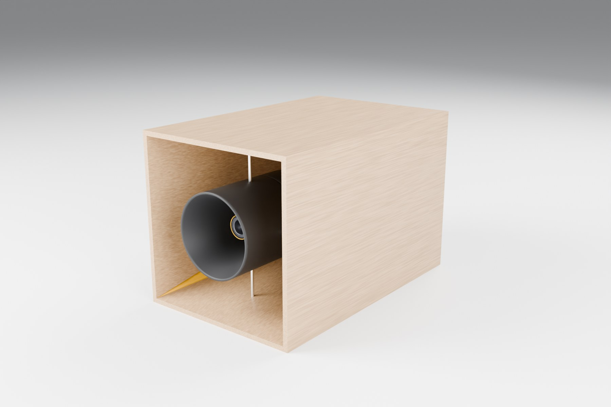
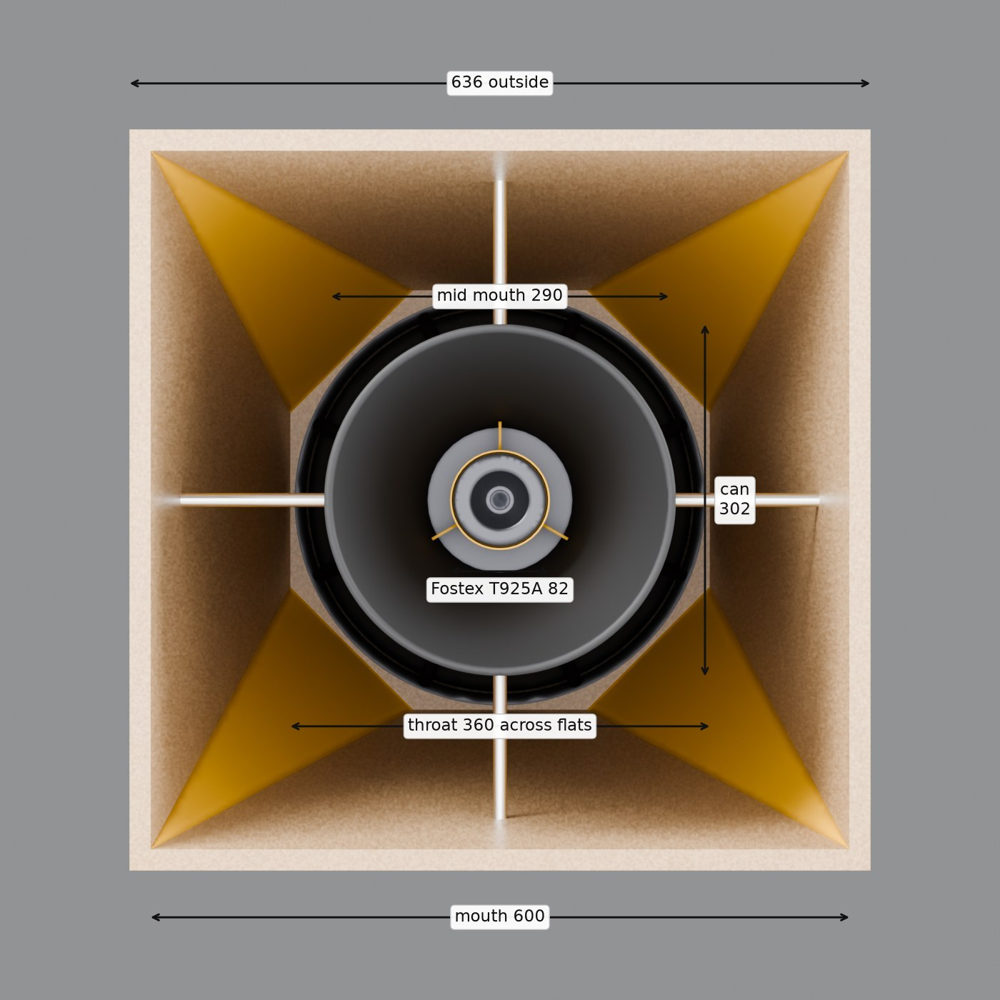

# Sunflower

A three-way coaxial horn loudspeaker where each horn's phase plug is the next horn.



- **Low:** an 18Sound 15W500, mounted backwards, drives a flat-panel horn from a 360 mm octagonal throat to a 600 mm square mouth over 850 mm. The driver's motor and a printed nose are its phase plug.
- **Mid:** a PRV 6MR600X-NDY loads an exponential horn, 290 mm mouth and 260 mm long, through an annular throat. The horn, driver and tail sit in a 302 mm can in the low horn's mouth, where the can is the low horn's centre body.
- **Tweeter:** a Fostex T925A bullet tweeter (82 mm body) sits in the mid throat in a printed sleeve, and is the mid horn's phase plug.

Every size, both crossovers, all three drivers and the tweeter came out of a joint optimisation with explicit size limits (`src/sunflower/optimise.py`).

Site with renders, per-horn plots, the full-range response and build instructions: **https://timini.github.io/sunflower/**



## Simulated performance

| | |
|---|---|
| Sensitivity | 104.4 dB, 2.83 V, 1 m |
| Response | 69 Hz to 16 kHz, -3 dB, on axis after DSP |
| Flatness | 4.9 dB peak to peak, 100 Hz to 16 kHz, before EQ |
| Crossovers | LR4 at 400 Hz and 6000 Hz, active |
| Cabinet | 636 x 636 x 982 mm, 18 mm birch ply |

These come from plane-wave horn models coupled to Thiele/Small driver models, with the tweeter's published response. Axisymmetric FEM of the mid and low horns agrees within 3.2 dB and 0.7 dB on axis in their bands. Nothing has been built or measured yet.

## Repository

| Path | What it is |
|---|---|
| `src/sunflower/optimise.py` | Joint search over tweeter, mid driver and horn, low driver and horn, with a size trade-off |
| `src/sunflower/design.py` | The selected design, loaded from `results/optimise/selected.json` |
| `src/sunflower/geometry.py` | Nested area functions of the low and mid horns, five flare profiles |
| `src/sunflower/acoustics.py` | Plane-wave horn network, driver model, curved-wavefront radiation |
| `src/sunflower/tweeters.py`, `data/tweeters/` | Bullet tweeters from their datasheets |
| `src/sunflower/simulate.py` | Section responses, crossover tuning and the summed system |
| `src/sunflower/fem.py`, `fem/axisym.py` | Axisymmetric FEM check in the dolfinx Docker image |
| `src/sunflower/cad.py` | STEP, STL and DXF for every part, cut list |
| `blender/render.py`, `src/sunflower/annotate.py` | Cycles renders and dimension overlays |
| `src/sunflower/plots.py`, `src/sunflower/site.py` | Figures and the GitHub Pages site in `docs/` |
| `data/drivers/` | Driver catalogues. `verified/` holds the records checked by hand against datasheets; `excluded.json` lists drivers removed and why |

## Reproduce

Needs [uv](https://docs.astral.sh/uv/), [just](https://just.systems), Docker for the FEM step, Blender 4.2 or later for renders, and ffmpeg for the turntable GIF.

```sh
just all     # optimise, sim, cad, fem, plots, render, site, test
just test    # tests only
just serve   # preview the site at http://localhost:8000
```

## Licence

MIT
