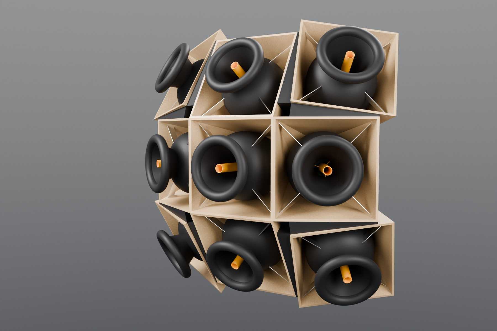

# Sunflower

A three-way coaxial horn after the Funktion-One Res 2: a kick horn up to 250 Hz, a cone mid that carries the voice from 250 Hz to 4 kHz, and a 1 inch compression driver above, nested on one axis. The HF horn is the mid's phase plug; the mid horn is the core of the kick's centre body.



Designed from the inside out:

1. **HF:** 18 Sound ND1030, 65 mm body cylinder, on a printed horn inside the mid phase plug.
2. **Mid phase plug:** one smooth bullet. Its nose follows the mid cone, it holds the HF body, and it tapers to the HF mouth. Felt under the nose damps the cavity between it and the cone.
3. **Mid:** Beyma 8MI100 in a 360 mm OS horn, 2.2:1 compression, the bullet always subtracted. It protrudes 150 mm past the kick mouth.
4. **Kick:** a reversed 18 Sound 15MB700 under a shroud that follows the cone at a constant-compression gap. A centre body solved from the hyperbolic-exponential (T = 0.6) law runs inside a single-ply square frustum, with corner fillers that make the throat an octagon and vanish at the square mouth.
5. **Cabinet:** 791 mm square at the mouth, 470 mm at the back, 600 mm deep. All four walls splay, so boxes sit 30 degrees apart in both directions; nine make a 3 x 3 curved point source.

Site with renders, videos, each horn's plots, the full-range response and build instructions: **https://timini.github.io/sunflower/**

## Simulated performance

| | |
|---|---|
| Sensitivity | 104 dB, 2.83 V, 1 m |
| Kick low end | -6 dB at 104 Hz on the ground; use with a sub |
| No-sub shelf | -6 dB at 92 Hz, kick limited to about 163 W |
| Crossovers | LR4 at 250 Hz and 4000 Hz |
| Drivers | about $509 per box |

Each horn is modelled from its real profile with a plane-wave network in which the cone is a distributed source. The chosen design is checked with axisymmetric FEM, using the cone as a vibrating boundary, and a 3D model of the square kick horn. The kick agrees within 0.9 dB RMS from 40 to 250 Hz. The mid agrees to 2.7 kHz; above that, the FEM shows a cavity loss that set the 4 kHz crossover. The CAD air volumes, sliced, match the horn models' areas.

Nothing has been built or measured. Driver cone and basket shapes are estimated from datasheet drawings and must be checked before printing.

## Repository

| Path | What it is |
|---|---|
| `src/sunflower/geometry.py` | Drivers, mid horn and bullet, kick horn, shroud, centre body, frustum, array layout |
| `src/sunflower/models.py`, `acoustics.py` | Acoustic networks built from the geometry; driver coupling |
| `src/sunflower/optimise.py` | Inside-out search: HF and mid, then kick and cabinet, then the system; crossover re-picked after FEM |
| `src/sunflower/simulate.py` | Sections, crossover tuning, EQ, the no-sub shelf, the 3 x 3 low end |
| `src/sunflower/design.py` | The selected design, from `results/optimise/selected.json` |
| `src/sunflower/fem.py`, `fem/` | Axisymmetric and 3D FEM in the dolfinx Docker image |
| `src/sunflower/cad.py` | STEP, STL, print-bed sections, DXF, cut list, array layout and spacers, CAD area check |
| `blender/render.py`, `src/sunflower/annotate.py` | Cycles stills, videos and dimension overlays |
| `src/sunflower/plots.py`, `src/sunflower/site.py` | Figures and the GitHub Pages site |
| `data/drivers/` | Kick and mid candidates with datasheet links and prices; `excluded.json` lists removed parts and why |

## Reproduce

Needs [uv](https://docs.astral.sh/uv/), [just](https://just.systems), Docker for FEM, Blender 4.2 or later, ffmpeg.

```sh
git clone https://github.com/timini/sunflower
cd sunflower
just all
```

MIT licence.
